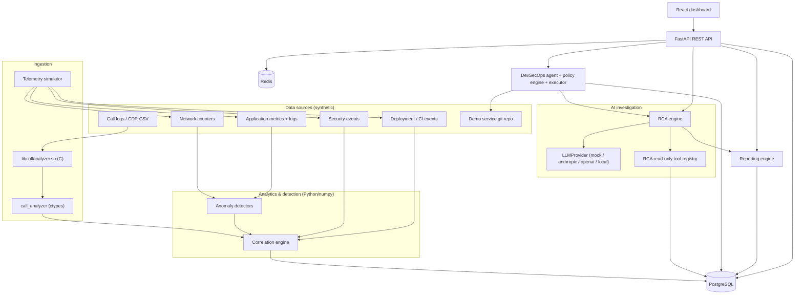
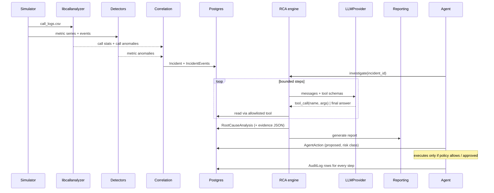

# Aegis-Net Architecture

This document describes components, data flow, and the contracts between them.
Where a contract is implemented in code, the code is authoritative and this
document is updated alongside it (CLAUDE.md). Sections marked *(planned)* are
designs for milestones not yet implemented — see `IMPLEMENTATION_PLAN.md`.

## 1. Component overview



| Component | Location | Language | Responsibility |
|---|---|---|---|
| Call analyzer library | `c-library/` | C11 | Parse/validate CDR CSV, aggregate, detect call-level outliers |
| Binding | `backend/call_analyzer/` | Python (ctypes) | Load `.so`, marshal structs → dicts, map errors to exceptions |
| Telemetry simulator | `backend/app/simulation/` | Python | Causal time-series model, incident injection, event streams *(planned M3)* |
| Analytics | `backend/app/analytics/` | Python/numpy | Detectors, scoring, correlation into incidents *(planned M4–M5)* |
| LLM layer | `backend/app/llm/` | Python | Provider abstraction *(planned M7)* |
| RCA engine | `backend/app/rca/` | Python | Tool-driven investigation loop, schema-validated output *(planned M7)* |
| Reporting | `backend/app/reporting/` | Python/Jinja2 | JSON/Markdown/HTML reports *(planned M8)* |
| DevSecOps agent | `backend/app/agents/` | Python | State machine, allowlisted tools, policy, approvals *(planned M9)* |
| API | `backend/app/api/` | FastAPI | REST + OpenAPI, auth, RBAC, rate limits *(planned M6/M10)* |
| Database | `backend/alembic/` | PostgreSQL | Relational entities + JSON evidence *(planned M6)* |
| Frontend | `frontend/` | React/TS | NOC dashboard *(planned M12)* |

## 2. End-to-end data flow



## 3. Interfaces

### 3.1 C library (`c-library/include/call_analyzer.h`) — implemented (M1)

The header is the authoritative contract. Conventions:

- All functions returning `int` return `CA_OK` (0) or a negative `CaStatus`
  error; `call_analyzer_strerror()` gives a static message.
- Output arrays are allocated by the library and released only with the
  matching `free_*` function. Outputs are set to `NULL`/0 on failure.
- No global mutable state; functions are re-entrant and thread-safe given
  distinct outputs.
- Fixed-size string fields (`char[32]`) are always NUL-terminated; inputs that
  would not fit are rejected, never truncated.

Input CSV schema (header optional, columns in this order):

```
timestamp,caller,callee,cell_id,duration,status_code,signal_strength,packet_loss
2026-03-01T14:05:00Z,+15550001,+15550002,CELL-102,184,200,-82,1
```

| Field | Type | Valid range |
|---|---|---|
| timestamp | ISO-8601 UTC `YYYY-MM-DDTHH:MM:SS[Z]` | years 1970–9999 |
| caller, callee | `[0-9A-Za-z+*#._-]`, 1–31 chars | |
| cell_id | `[0-9A-Za-z._-]`, 1–31 chars | |
| duration | integer seconds | 0–86400 |
| status_code | integer, see below | 100–999 |
| signal_strength | integer dBm | −150–0 |
| packet_loss | integer percent | 0–100 |

Status-code classification (SIP-inspired, defined by Aegis-Net):

| Range | Class | Meaning |
|---|---|---|
| 200–299 | `CALL_COMPLETED` | Call completed normally |
| 900–999 | `CALL_DROPPED` | Established call terminated abnormally (e.g. 901 radio link failure, 902 handover failure, 903 congestion, 904 core timeout) |
| 300–899 | `CALL_SETUP_FAILED` | Call never established (e.g. 408 timeout, 486 busy, 503 unavailable) |
| 100–199 | `CALL_UNKNOWN` | Provisional — not counted as success or failure |

Rates: `success_rate = completed / total`; `drop_rate = dropped / (completed + dropped)`
(drops relative to established calls, the conventional definition);
`setup_failure_rate = setup_failed / total`.

Main entry points (see header for full signatures and struct definitions):

```c
int parse_call_log(const char *filepath, CallRecord **records, size_t *count);
int parse_call_log_ex(const char *filepath, const ParseOptions *opts,
                      CallRecord **records, size_t *count, ParseReport *report);
int parse_call_log_buffer(const char *data, size_t len, const ParseOptions *opts,
                          CallRecord **records, size_t *count, ParseReport *report);
int calculate_statistics(const CallRecord *, size_t, CallStatistics *);
int calculate_cell_statistics(const CallRecord *, size_t, CellStatistics **, size_t *);
int calculate_failure_code_statistics(const CallRecord *, size_t, FailureCodeStatistics **, size_t *);
int calculate_time_window_statistics(const CallRecord *, size_t, int64_t window_seconds,
                                     TimeWindowStatistics **, size_t *);
int calculate_caller_statistics(const CallRecord *, size_t, CallerStatistics **, size_t *);
int detect_call_anomalies(const CallRecord *, size_t, const AnomalyConfig *,
                          CallAnomaly **, size_t *);
```

Anomaly detection uses robust z-scores, `z = (x − median) / max(1.4826·MAD, floor)`,
across cells, time windows, callers and individual durations, with minimum
sample sizes and absolute-difference floors to suppress noise. Score is
`1 − 2^(−z/threshold)` (0.5 at the threshold), mapped to severity bands.

### 3.2 Python binding (`backend/call_analyzer/`) — implemented (M2)

```python
from call_analyzer import analyze_call_log
result = analyze_call_log("data/call_logs/call_logs.csv", window_seconds=300,
                          strict=False, max_records=None, anomaly_config=None)
```

Modules: `_native.py` (ctypes struct mirrors, `argtypes`/`restype` for every
function used, library discovery, ABI check), `analysis.py` (marshalling and
memory ownership), `errors.py` (exceptions), `types.py` (TypedDicts).

**All computation is in C.** The binding calls `parse_call_log_ex`,
`calculate_statistics`, `calculate_cell_statistics`,
`calculate_failure_code_statistics`, `calculate_time_window_statistics`,
`calculate_caller_statistics` and `detect_call_anomalies`. Names for outcomes,
anomaly types and severities come from the C `*_name` functions, and anomaly
defaults come from `anomaly_config_default`. The only Python-side derivation is
`suspicious_time_windows`, which groups the window-category anomalies returned
by C and joins them to that window's C statistics.

Result (`CallAnalysisResult`, JSON-serialisable): `source, library_version,
window_seconds`, overall `total_calls, successful_calls, failed_setup_calls,
dropped_calls, unknown_calls, success_rate, drop_rate, setup_failure_rate,
average_duration, duration_stddev, min_duration, max_duration, average_signal,
average_packet_loss, weak_signal_calls, unique_cells, unique_callers,
first_epoch/last_epoch, first_timestamp/last_timestamp` (None when empty), and
lists `cells[], failure_codes[], time_windows[], callers[], anomalies[],
suspicious_time_windows[]`, plus `parse_report{}`. Each anomaly follows the
spec §6 vocabulary: `type, category (cell|window|caller|call), severity,
subject, window_start/window_end (ISO + epoch), value, baseline, z_score,
anomaly_score, sample_size, record_index, description`.

Memory ownership: every native array is converted to Python values and then
released with its matching `free_*` in a `finally` block. `free_call_records`
runs after all analyses (also on error paths). No native pointer escapes the
call.

Library discovery (`resolve_library_path`), always loading by absolute path,
never via the dynamic linker search path:
1. `CALL_ANALYZER_LIB` if set to a non-blank value. A missing or unloadable file is an error; the binding never falls back silently. An empty or whitespace-only value counts as unset.
2. `<repo>/c-library/build/libcallanalyzer.so` (local `make c-build`).
3. `/usr/local/lib/libcallanalyzer.so` (Docker / `cmake --install`).

Tests additionally compile an `offsetof`/`sizeof`/`_Generic` probe against the
header and compare every field's name, order, offset, size and type class with
the mirrors (`test_binding_abi_and_ownership.py`).

On load, the binding checks that the major version is 1 and that every
`CaStructSizes` entry equals `ctypes.sizeof` of the Python mirror. If either
check fails, it raises `LibraryLoadError`.

Errors: `CallAnalyzerError` carries `code` (original `CaStatus`), `code_name`,
`c_message` (from `call_analyzer_strerror`) and, for parse failures,
`parse_report`. Subclasses: `NullArgumentError` (-1), `InvalidArgumentError`
(-2), `CallLogIOError` (-3), `OutOfMemoryError` (-4), `CallLogParseError` (-5),
`CallAnalyzerOverflowError` (-6), `LimitExceededError` (-7), and
`LibraryLoadError` (no code). Suspicious-window grouping raises
`CallAnalyzerError` if C returns a window anomaly with no matching window
statistics, rather than inventing values. Arguments that cannot be passed to C at all
(non-int window, `window_seconds` outside int64 which ctypes would silently
wrap, NUL in the path, negative `max_records`, numeric overrides that overflow
a C double or size_t, unknown `anomaly_config` keys) raise `TypeError`/`ValueError`. Range checks such as
`window_seconds` are left to C.

### 3.2a Call-log generator (`scripts/generate_call_logs.py`) — implemented (M2)

Standalone script with no dependency on the backend. `--seed` plus arguments
produce byte-identical CSV, verified identical on Python 3.12 and 3.14. Healthy
baseline: 12 cells (`CELL-101…112`), Poisson arrivals (~40/min with a ±15 %
load cycle), gamma durations (mean 125 s), 2.5 % setup failures and 1.2 % drops.
Optional fault (`--faulty-cell`, default `CELL-107`, `none` disables it): a
progressive radio degradation in which severity ramps 0.3→1.0 over the first
half of the window. Signal falls by up to 22 dB, packet loss rises by up to
14 pp, drops rise by up to 35 pp (mostly 901/903), and setup failures rise
(408/503). `--manifest` writes the injected ground truth plus the CSV's SHA-256.
The default fault is cell-local, so the C library reports it as cell anomalies.
It is usually too diluted across all cells to trigger window anomalies.

### 3.2b Telemetry simulator (`backend/app/simulation/`) — implemented (M3)

`simulate(Scenario) -> SimulationResult` is deterministic for a given scenario:
it uses NumPy `SeedSequence` with independent streams for profiles, incidents,
background events and each cell. Default topology: 12 cells (`CELL-101…112`)
served by 3 packet-gateway nodes (`pgw-1…3`, 4 cells each), 1-minute
resolution, 6 hours from 2026-03-01T12:00Z.

- `metrics.py` — the 17 spec §5 KPIs with units, physical bounds and the bad
  direction (consumed by M4).
- `model.py` — causal model per cell, with AR(1) noise on every metric:
  diurnal users → CPU and offered load; memory → CPU (GC pressure above 75 %);
  CPU → queueing latency → jitter; CPU saturation and interface faults →
  loss → retransmissions and goodput; radio penalty → RSRP/RSSI/RSRQ/SINR →
  handovers and drops; latency/loss/SINR → setup success and drops.
- `incidents.py` — the 9 incident types. They only modify *drivers* (load
  factor, extra CPU/memory, interface loss, radio penalty, configuration
  penalties) and emit events. Node-scoped types (`memory_leak`,
  `software_deployment_regression`) target a `pgw-N` and create a
  `DeploymentRecord`.
- `scenario.py` — rollback support: `rollback_minute` ends deployment-induced
  effects, with memory freed over 3 minutes, and emits a `rollback` event.
  The seeded scenario (`seeded_memory_leak_scenario`) deploys
  packet-gateway 2.4.1 to pgw-1 at 14:05. A benign hotfix deployment on pgw-3
  at 13:10 is a deliberate distractor for correlation.
- `cdr.py` — CDRs drawn from each cell's KPIs (C-library CSV schema).
- `io.py` — outputs: `data/network_metrics/network_metrics.csv` (wide:
  timestamp, cell_id, node_id, 17 KPIs), `data/incidents/events.jsonl`,
  `deployments.jsonl`, `ground_truth.json`,
  `data/security/security_events.jsonl`, `data/call_logs/call_logs.csv`.

Ground truth is for tests and the demo only; detection and RCA never read it.
Synthetic IPs use the documentation ranges 203.0.113.0/24 (attack) and
198.51.100.0/24 (background).

### 3.3a Anomaly detection (`backend/app/analytics/`) — implemented (M4)

Input: `MetricSeries(metric, cell_id, node_id, epochs, values)` (adapters in
`sources.py` for simulator output and the metrics CSV). The detection modules
import only the KPI catalogue from the simulator, which is enforced by a test.
Per point, in time order (`detectors.evaluate_series`):

| Detector | Rule |
|---|---|
| `zscore` | Trailing 60-min time-window mean/std of admitted points; z = (x − mean)/max(std, floor) |
| `ewma` | Time-aware EWMA mean/variance (τ = 15 min) of admitted points |
| `rate_of_change` | Per-minute change vs the median/MAD of recent healthy changes (z ≥ 5) |
| `threshold` | Static warning/critical levels per KPI (`config.DEFAULT_RULES`) |

- A point is **flagged** on a threshold breach, on zscore and EWMA both
  ≥ z 4, or on rate-of-change plus one of them. Statistical hits also
  need a per-metric practical deviation (`min_delta`).
- Only clearly normal points (|z| < 2.5) update the baseline. After 6 h
  without admissions the series re-baselines.
- Flagged points within 5 min form an episode (≥ 2 points, or a single point
  scoring ≥ 0.85).
- `MetricAnomaly` carries the spec §6 fields: `metric`, `timestamp` (onset),
  `value` (extreme), `baseline` (at onset), `severity`, `anomaly_score`
  (0.5 at threshold, same mapping as the C library) and `related_metrics`
  (same-cell episodes overlapping within 15 min), plus id, cell, node,
  start/end, detectors and points.
- Isolation Forest / DBSCAN (optional in spec §6) are not implemented.

### 3.3b Correlation engine (`backend/app/analytics/correlation.py`) — implemented (M5)

```python
correlate(anomalies: Sequence[MetricAnomaly], events: Iterable[OperationalEvent] = (),
          call_anomalies: Sequence[AnomalyDict] = (),            # from call_analyzer (C library)
          series: Mapping[(cell, metric), (epochs, values)] | None = None,
          config: CorrelationConfig | None = None) -> list[Incident]
```

1. **Clustering.** Per cell, episodes within 15 min form a cluster. Clusters
   on the same node merge when their onsets are within 15 min; different
   nodes never merge.
2. **Incident gate.** An incident needs ≥ 2 distinct symptom metrics and at
   least one symptom of severity ≥ high. M4 bounds false positives to
   low/medium, so coincidental noise never opens an incident. Measured: 0
   incidents over 20 healthy days.
3. **Candidate causes** (`SuspectedCause`, always `status: "hypothesis"`),
   scored as `0.45·temporal + 0.35·mechanism + 0.2·topology`:
   - *Temporal:* exp(−lead/30 min) for events up to 2 h before onset, 0.3
     within 5 min after onset.
   - *Mechanism:* half the share of the earliest symptoms (within 2 min of
     onset) that the cause produces first, half the share of all symptoms it
     explains downstream in the causal graph (`causal_graph.py`).
   - *Topology:* 1.0 when the event targets the affected node or cell, 0.5
     for symptom-only causes.
   - Event-backed classes: `deployment_regression`, `configuration_change`,
     `security_attack` (≥ 10 IDS events). Symptom-only classes:
     `memory_exhaustion`, `traffic_overload`, `radio_degradation`,
     `transport_fault`.
   - Deployments and config changes on other elements are listed in
     `excluded_candidates` with a reason.
4. **Confidence** = top score × (0.6 + 0.4·chain consistency) × (0.9 if the
   top two hypotheses are within 0.1), capped at 0.95.
   - Chain consistency is the share of effects preceded by at least one
     observed upstream cause.
   - Caveats always state that correlation is not causation. They also flag
     close calls, single candidates, symptom-only inference and order
     violations.
5. **Output.** An `Incident` carries the spec §7 fields (`incident_id`
   `INC-YYYY-NNN`, `severity` LOW/MEDIUM/HIGH/CRITICAL, `start_time`,
   `affected_cells`, `symptoms`, `events`, `suspected_causes`,
   `confidence`). Also included:
   - `affected_nodes` and `excluded_candidates`;
   - `call_evidence` (C-library cell anomalies for the affected cells, plus
     network-wide window anomalies);
   - `causal_chain` (onset lags, plus the lagged cross-correlation of first
     differences when series are supplied);
   - `chain_consistency`, `caveats`, and `anomaly_ids`.
6. **Timeline.** Changes on the affected topology from the look-back window,
   the first 10 warning/error application logs during the incident, one
   entry per symptom onset, and `incident_created` when the second symptom
   appears.

Not correlated into incidents: C-library caller and per-call anomalies (fraud
patterns rather than network faults). They remain available from the C
analysis result.

### 3.4 LLM providers and RCA engine (`backend/app/llm/`, `backend/app/rca/`) — implemented (M7)

**Provider abstraction** (`llm/base.py`): `LLMProvider.generate(system, messages)` and
`LLMProvider.tool_call(system, messages, tools)` over neutral messages
(`UserMessage`, `AssistantMessage` carrying the provider's raw content for
unchanged echo, `ToolResultsMessage`). Errors are normalised to
`LLMRefusalError`, `LLMRateLimitError` (retryable), `LLMUnavailableError`
(retryable) and `LLMConfigurationError`. Providers never execute tools.

| `LLM_PROVIDER` | Class | Notes |
|---|---|---|
| `mock` (default) | `MockProvider` | Deterministic, rule-based (`rca/mock_investigator.py`), not an LLM. Also used whenever the selected provider lacks a key/URL/SDK; the fallback reason is returned by the API. |
| `anthropic` | `AnthropicProvider` | Official `anthropic` SDK 1.15. Default model `claude-opus-5-5`; no `thinking` parameter (adaptive is always on); `output_config.effort="high"`; `strict` tools with `tool_choice` left at auto; server-side refusal fallbacks (`fallbacks="default"`, beta `server-side-fallback-2026-07-01`); `stop_reason == "refusal"` checked first; assistant content echoed unchanged; SDK errors mapped specific-first. |
| `openai` | `OpenAIProvider` | Chat Completions with `strict` function tools; malformed tool-call JSON is passed to the engine as an invalid-arguments error. |
| `local` | `OpenAIProvider(base_url=LOCAL_LLM_BASE_URL)` | Any OpenAI-compatible server (Ollama, vLLM). |

Vendor SDKs are optional (`backend/requirements-llm.txt`). The request
shapes were checked against the installed SDK signatures (anthropic 1.15.0,
openai 3.35.1). Live API calls are covered only by an opt-in test
(`AEGIS_RUN_LIVE_LLM_TESTS=1`), which was **not executed** in this
environment (no key).

**RCA tools** (`rca/tools.py`, spec §8 names): `get_call_statistics`,
`get_cell_statistics`, `get_metric_history`, `get_anomalies`,
`get_related_events`, `get_recent_deployments`, `get_security_events`,
`get_logs`, `compare_baseline`.
- Each tool has a strict JSON schema (all properties required, nullable
  where optional, `additionalProperties: false`) and a Pydantic model that
  re-validates arguments (`extra="forbid"`, strict types).
- Inputs are bounded: known metrics, cell pattern, known services, time spans
  of 24 h or less.
- Access is read-only and scoped to the incident's run; `get_related_events`
  only answers for the incident under investigation.
- Outputs are bounded: series downsampled to ≤ 120 points, lists capped, and
  a 16 KB result limit.

**Investigation loop** (`rca/engine.py`):
- The opening prompt holds only identifiers and symptom names, not raw data.
- Each turn runs at most 8 tool calls (extras get errors); the loop allows
  10 steps.
- Unknown tools, invalid arguments and tool errors are returned to the model
  as `is_error` results and recorded, never executed.
- The final answer must be one JSON object validating as `RCAAnswer`
  (`rca/schemas.py`): `facts` (each cites ≥ 1 tool call id), `inferences`,
  `hypotheses` (cause type, confidence ≤ 0.95, supporting/contradicting
  evidence, assessment), `recommended_actions` (with risk class and optional
  agent tool) and `verification_steps`. The root cause must be the leading
  hypothesis.
- Citations must reference tool calls that happened. Facts and the leading
  hypothesis need at least one *successful* call.
- Rejected answers get feedback, up to 3 attempts; then the RCA is stored as
  `failed` with the reason, and no cause is invented.
- Provider thinking is never stored. Only structured summaries are kept
  (spec §26).

API: `POST /api/incidents/{id}/investigate` (operator) runs the loop,
persists `root_cause_analyses` and `recommendations`, moves the incident to
`investigating`, appends `ai_investigation_started` and
`root_cause_identified` (or `investigation_failed`) timeline events, and
audits `rca.investigate` with every tool call id. `GET
/api/incidents/{id}/rca` (viewer) returns the latest RCA plus the §26
`explanation` chain: observed evidence → correlated events → candidate
hypotheses → evaluation → root cause → confidence → remediation.

### 3.4a Reporting engine (`backend/app/reporting/`) — implemented (M8)

`build_report(session, incident_id, provider_choice, created_by) -> ReportDocument`
(Pydantic, `document.py`) produces one structured document. It is rendered as
JSON (`model_dump_json`), Markdown and HTML (Jinja2 templates in
`reporting/templates/`). PDF (optional in spec §9) is not implemented.

| Section | Source (computed, not generated) |
|---|---|
| KPI analysis | `network_metrics`: mean of the affected cells for the hour before onset vs the incident window, plus the worst value in the bad direction and % change |
| Anomaly analysis | incident symptoms (M4/M5) |
| Correlation analysis | symptom onset sequence (labelled temporal, not causal), chain consistency, ranked correlation hypotheses, excluded candidates, C-library call evidence |
| Root cause | latest completed RCA (facts with tool-call citations, inferences, alternatives), else the correlation hypothesis, always labelled as a hypothesis |
| Impact | affected cells/nodes, duration, users connected (mean `active_users` per cell, summed), dropped/failed calls from the C analysis |
| Recommendations, verification, confidence | RCA recommendations with risk classes; RCA and correlation confidence; caveats (incl. "not verified until recovery is confirmed") |
| Evidence references | RCA tool-call ids, anomaly ids, event ids |

The executive summary is the only generated prose. It comes from
`LLMProvider.generate` (the mock uses a deterministic template) and is
accepted only if every number in it appears in the JSON context the model was
given. Otherwise the template is used and `narrative_provider` records the
rejection; provider errors also fall back to the template.

Security: HTML is autoescaped, and Markdown table cells escape `|`, `\`, `<`,
`>` and newlines. Both are tested with injected `<script>`/``
payloads. The HTML endpoint sends
`Content-Security-Policy: default-src 'none'; style-src 'unsafe-inline'` and
`X-Content-Type-Options: nosniff`.

API: `POST /api/reports/generate {incident_id}` (operator, audited
`report.generate`) stores the document and both renderings
(`RPT-INC-YYYY-NNN-NN`). `GET /api/reports?incident_id=` and `GET
/api/reports/{report_id}?format=json|markdown|html` require viewer.

### 3.5 DevSecOps agent (`backend/app/agents/`, `demo-workspace/`) — implemented (M9)

**State machine** (`service.py`): OBSERVE → ANALYZE → PLAN → ACT → VERIFY →
CLOSE; a run's phase never moves backwards.
- The **planner** (`planner.py`) is deterministic: one playbook per scenario,
  driven only by earlier action results. It never acts on LLM text; the LLM
  contributes only through the RCA engine.
- Every action is stored with its **rationale before it executes**, and is
  audited when proposed, blocked, approved, denied, rejected, succeeded or
  failed.

**Policy** (`policy.py`, spec §12), re-checked inside `execute_action` (not
only in the API):

| Risk class | Behaviour |
|---|---|
| READ_ONLY, LOW_RISK | execute automatically |
| REQUIRES_APPROVAL | `awaiting_approval`; an approver who is not the run's initiator approves; an operator+ executes |
| HIGH_RISK | blocked unless `AGENT_ALLOW_HIGH_RISK=true`; then approval plus **admin** execution |
| BLOCKED | never executes (`delete_infrastructure` has no implementation) |

**Tools** (`tools.py`, spec §10):
- READ_ONLY: `inspect_repository`, `inspect_git_diff`, `run_unit_tests`,
  `run_linter` (pyflakes), `run_tests`, `run_security_scan`,
  `inspect_dependencies`, `inspect_container`, `inspect_logs`,
  `inspect_metrics`.
- LOW_RISK: `create_incident`, `request_rca`, `generate_patch`,
  `generate_report`, `close_incident`.
- REQUIRES_APPROVAL: `apply_patch`, `modify_dependency`, `restart_service`
  (not modelled by the simulator, so it always fails with an explanation).
- HIGH_RISK: `rollback_deployment`.
- BLOCKED: `delete_infrastructure`.

Arguments are Pydantic-validated (`extra="forbid"`, strict, patterns).

**Sandbox** (`runner.py`, `workspace.py`): each code-scenario run gets a
disposable copy of `demo-workspace/` under `AGENT_WORKSPACE_ROOT/<run>`
with its own git history. Commands are restricted as follows:
- **Executables:** only `python` (this interpreter, `-m pytest|pyflakes`)
  and `git` (`init|add|commit|diff|log|apply|status|rev-parse|show`, no
  `-c` overrides).
- **Invocation:** argv lists only, with `shell=False` enforced by a codebase
  AST test.
- **Confinement:** the working directory must be inside the workspace root,
  and workspace-relative paths are resolved and checked.
- **Environment:** scrubbed — no inherited secrets or `LD_PRELOAD`, no user
  or system git config.
- **Limits:** a timeout and output truncation.

**Scenarios** (spec §11):
1. `vulnerable_dependency`: scan, record a finding, find the smallest safe
   release, `modify_dependency` (needs approval; never deployed), re-test,
   re-scan, report, and mark the finding remediated.
2. `failed_ci`: reproduce the failure, read the CI log, diff the last
   commit, form a hypothesis (the changed module is exercised by a failing
   test), `generate_patch` (revert), `apply_patch` (needs approval), run the
   tests plus linter, report.
3. `production_anomaly`: inspect metrics, acknowledge the incident, run RCA,
   check the deployment registry, then `rollback_deployment` (HIGH_RISK).
   The rollback is **simulated**: the scenario is re-simulated with the
   rollback 45 min after onset, in a verification run that opens no
   incidents. Recovery is verified as the last 30 min of KPIs within the
   M4 practical deltas of the pre-incident baseline, with no open
   anomalies. Then the incident is closed and a report generated. With
   HIGH_RISK disabled, the rollback is recorded as `blocked` and the
   incident stays open with the RCA recommendation for humans.

Vulnerability data is a bundled synthetic database (`agents/data/advisories.json`,
`DEMO-CVE-` ids, fictional packages); nothing is fetched from the network.

API: `GET /api/agent/status` (policy table, pending approvals),
`GET /api/agent/actions`, `GET /api/agent/runs[/{id}]` (viewer),
`POST /api/agent/investigate {scenario, incident_id?}` (operator),
`POST /api/agent/approve/{action_id} {decision, comment}` (approver),
`POST /api/agent/execute/{action_id}` (operator; admin for HIGH_RISK).

### 3.6 Database (`backend/app/models/`, `backend/alembic/`) — implemented (M6)

SQLAlchemy 2 ORM + Alembic (`0001_initial_schema`). The same migration runs
on SQLite (offline demo, tests) and PostgreSQL 16 (Docker). That was verified
against a real `postgres:16` container: upgrade → `alembic check` (no drift)
→ pipeline → API. Timestamps are UTC epoch seconds (`*_epoch`, BigInteger).

| Table | Key relational columns | JSON (evidence/documents only) |
|---|---|---|
| `pipeline_runs` | scenario, seed, status, data window, fingerprint | params |
| `network_metrics` | run_id, epoch, cell_id, node_id, metric, value (index run/metric/cell/epoch) | — |
| `anomalies` | anomaly_id, run_id, metric, cell/node, start/end, value, baseline, severity, score | detectors, related_metrics |
| `call_analysis_runs` | totals and rates from libcallanalyzer | failure_codes, time_windows, suspicious windows, parse_report |
| `call_cell_statistics`, `call_anomalies` | per-cell stats; C anomalies (type, severity, subject, window, value, z, score) | — |
| `operational_events`, `deployments` | type/time/node/cell; service, versions, status, rollback time | attributes |
| `incidents` (+ `incident_cells`, `incident_anomalies`, `incident_events`) | severity, status, window, confidence, top cause, resolved time; cell/node and anomaly links; timeline rows | symptoms, suspected_causes, excluded_candidates, call_evidence, causal_chain, caveats |
| `root_cause_analyses`, `recommendations`, `reports` | provider/model/status/root cause/confidence; action, risk class, tool | facts, inferences, hypotheses, evidence, tool_calls; report payload |
| `agent_runs`, `agent_actions`, `security_findings` | state/status; tool, risk class, status, approver/executor and times; severity/status | arguments, result, details |
| `audit_logs` | epoch, actor, role, action, resource, outcome, request_id, prev_hash, hash | details |

Analytics identifiers are deterministic per scenario, so stored ids are made
run-scoped (`R<run>-ANOM-…`, `R<run>-EVT-…`, `R<run>-DEP-…`). Incident ids are
allocated globally in sequence (`INC-2026-001`, `INC-2026-002`, …).

### 3.7 REST API (`backend/app/api/`, `backend/app/main.py`) — implemented M6 (core)

Auth:
- `Authorization: Bearer <token>`. Tokens are configured only as SHA-256
  hashes in `AEGIS_API_TOKENS` (`name:role:hash`; `scripts/hash_token.py`)
  and compared in constant time.
- Roles are ordered: viewer < operator < approver < admin.
- 401 and 403 responses are written to the audit log (`auth.denied`,
  `auth.forbidden`).

| Endpoint | Role |
|---|---|
| `GET /api/health` (status, db, C library, provider; no secrets) | public |
| `POST /api/pipeline/run` (`{scenario: seeded\|healthy, seed, minutes, rollback_minute}`), `GET /api/pipeline/runs` | operator / viewer |
| `GET /api/calls/statistics`, `GET /api/calls/anomalies` (`?run_id`, default latest run) | viewer |
| `GET /api/network/metrics?metric=&cell_id=&start=&end=&run_id=`, `GET /api/network/anomalies?cell_id=&metric=&severity=` | viewer |
| `GET /api/incidents?status=&severity=`, `GET /api/incidents/{id}` (detail with timeline, cells, anomaly ids) | viewer |
| `GET /api/deployments`, `GET /api/security/findings` | viewer |
| `GET /api/audit?action=&limit=&offset=` | operator |
| `GET /api/audit/verify` (hash-chain check) | admin |

Request bodies use `extra="forbid"`. Query parameters are pattern- or
range-validated (metric names, cell ids, incident ids, severities, limits
≤ 1000). Every response carries `X-Request-ID` (a valid incoming value is
echoed, otherwise one is generated), and it is stored in audit rows. OpenAPI
is served at `/openapi.json` and `/docs`. RCA, report and agent endpoints are
added in M7–M9.

Audit log: append-only. Each row's SHA-256 covers its content and the previous
row's hash; on PostgreSQL appends are serialised with an advisory lock.
`verify_chain` detects modified or removed rows.

### 3.7a Hardening and observability (`app/security/middleware.py`, `app/observability/`) — implemented (M10)

ASGI middleware, outermost first:

1. `RequestContextMiddleware` handles request IDs, access logs, metrics and
   errors. It echoes a valid `X-Request-ID` or generates one, and writes a
   JSON access-log line (method, route *template*, status, duration,
   actor). It updates Prometheus counters and histograms, and converts
   unhandled exceptions into `500 {"detail": "internal server error",
   "request_id"}` with no internals.
2. `SecurityHeadersMiddleware` adds `nosniff`, `X-Frame-Options: DENY` and
   `Referrer-Policy: no-referrer`. `/api/*` responses also get
   `Cache-Control: no-store` and `CSP: default-src 'none'` unless already
   set.
3. `BodySizeLimitMiddleware` returns 413 when `Content-Length` exceeds
   `AEGIS_MAX_REQUEST_BYTES` (default 1 MB), or when a streamed or chunked
   body grows past it.
4. `RateLimitMiddleware` applies a fixed per-minute window keyed by a SHA-256
   prefix of the Authorization header, or by client IP when absent
   (`AEGIS_RATE_LIMIT_PER_MINUTE`, default 120; the Docker stack uses 600).
   It returns 429 with `Retry-After`. `/api/health` and `/metrics` are
   exempt.
   - **Backend:** Redis when `REDIS_URL` is set. On Redis errors it falls
     back to an in-process limiter and logs, so it neither fails open nor
     returns errors.
   - **Verification:** tested against a live `redis:7` (7.4.11) via the
     opt-in `AEGIS_TEST_REDIS_URL` test.

**Logging:** JSON lines on logger `aegis`. A log-record factory stamps
`request_id`, `incident_id` and `agent_run_id` (context variables set by
the request middleware, the RCA endpoint and the agent run loop) onto every
record when it is created, so deferred formatting keeps them. Tokens and
API keys are never logged (tested).

**Metrics:** `/metrics` (Prometheus text format, one registry per app) exposes:
- `aegis_http_requests_total{method,route,status}`;
- `aegis_http_request_duration_seconds`;
- `aegis_http_errors_total`, `aegis_rate_limited_total`;
- `aegis_agent_actions_total{tool,status}`, `aegis_rca_runs_total{provider,status}`.

Route labels use templates (bounded cardinality). `/metrics` is
unauthenticated but contains no identifiers or secrets. In Docker it is not
exposed through the frontend proxy.

Tokens are accepted only as `Authorization: Bearer` (not from query
strings, cookies, `Basic` or other headers). Method-override headers are
ignored. Injection- and traversal-shaped parameters are rejected by
pattern validation (tests cover SQL fragments, `<script>`, `../`, encoded
`..` and NUL). OpenTelemetry (optional in spec §21) is not implemented.

### 3.8 Frontend — *(planned M12)*

React/TS SPA served by nginx; talks only to the REST API through a typed
client in `frontend/src/services/api.ts` whose types mirror the Pydantic schemas.

## 4. Trust boundaries

1. CSV input → C parser: untrusted; bounded line/field lengths, strict validation.
2. LLM output → RCA/agent: untrusted; schema-validated, allowlisted tools only.
3. HTTP clients → API: authenticated, RBAC, rate-limited, size-limited.
4. Agent → OS: fixed executables, argv lists, timeouts, confined cwd, minimal env.

## 5. Development and deployment strategy

Local development (WSL2):

- C: `make c-build`, `make c-test`, `make c-test-asan` (CMake out-of-tree builds under `c-library/build*`).
- Python: `make py-venv` (pinned dev tools in `backend/requirements-dev.txt`), `make py-test`, `make py-typecheck`; the binding finds the locally built `.so`.
- Data: `make call-logs SEED=42` writes `data/call_logs/call_logs.csv` + manifest (git-ignored, reproducible).
- Frontend: Node is not installed in WSL; use the `node` container (`make frontend-test`) *(planned)*.

Docker (`docker compose up --build`) *(planned M11–M12)*:

| Service | Image | Notes |
|---|---|---|
| `postgres` | `postgres:16` | volume, healthcheck |
| `redis` | `redis:7` | rate limit + queue |
| `backend` | multi-stage: stage 1 builds + tests the C library with CMake; stage 2 `python:3.12-slim` with `.so` in `/usr/local/lib` | runs `alembic upgrade head` then uvicorn |
| `frontend` | multi-stage: `node` build → `nginx` | proxies `/api` to backend |

Secrets come only from `.env` (git-ignored); `.env.example` documents variables.
With no `ANTHROPIC_API_KEY`/`OPENAI_API_KEY`, `LLM_PROVIDER` falls back to `mock`.
