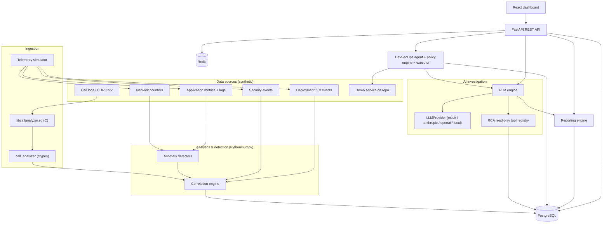
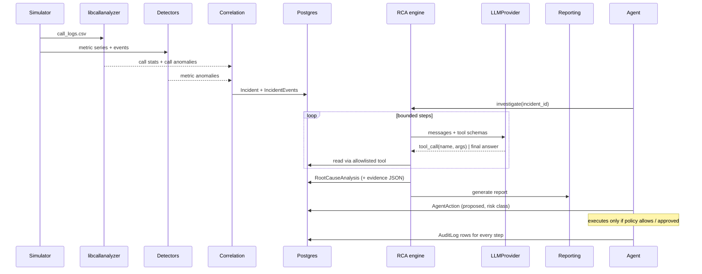

# Aegis-Net Architecture

This document describes components, data flow, and the contracts between them.
Where a contract is implemented in code, the code is authoritative and this
document is updated alongside it (CLAUDE.md). Sections marked *(planned)* are
designs for milestones not yet implemented — see `IMPLEMENTATION_PLAN.md`.

## 1. Component overview



| Component | Location | Language | Responsibility |
|---|---|---|---|
| Call analyzer library | `c-library/` | C11 | Parse/validate CDR CSV, aggregate, detect call-level outliers |
| Binding | `backend/call_analyzer/` | Python (ctypes) | Load `.so`, marshal structs → dicts, map errors to exceptions |
| Telemetry simulator | `backend/app/simulation/` | Python | Causal time-series model, incident injection, event streams *(planned M3)* |
| Analytics | `backend/app/analytics/` | Python/numpy | Detectors, scoring, correlation into incidents *(planned M4–M5)* |
| LLM layer | `backend/app/llm/` | Python | Provider abstraction *(planned M7)* |
| RCA engine | `backend/app/rca/` | Python | Tool-driven investigation loop, schema-validated output *(planned M7)* |
| Reporting | `backend/app/reporting/` | Python/Jinja2 | JSON/Markdown/HTML reports *(planned M8)* |
| DevSecOps agent | `backend/app/agents/` | Python | State machine, allowlisted tools, policy, approvals *(planned M9)* |
| API | `backend/app/api/` | FastAPI | REST + OpenAPI, auth, RBAC, rate limits *(planned M6/M10)* |
| Database | `backend/alembic/` | PostgreSQL | Relational entities + JSON evidence *(planned M6)* |
| Frontend | `frontend/` | React/TS | NOC dashboard *(planned M12)* |

## 2. End-to-end data flow



## 3. Interfaces

### 3.1 C library (`c-library/include/call_analyzer.h`) — implemented (M1)

The header is the authoritative contract. Conventions:

- All functions returning `int` return `CA_OK` (0) or a negative `CaStatus`
  error; `call_analyzer_strerror()` gives a static message.
- Output arrays are allocated by the library and released only with the
  matching `free_*` function. Outputs are set to `NULL`/0 on failure.
- No global mutable state; functions are re-entrant and thread-safe given
  distinct outputs.
- Fixed-size string fields (`char[32]`) are always NUL-terminated; inputs that
  would not fit are rejected, never truncated.

Input CSV schema (header optional, columns in this order):

```
timestamp,caller,callee,cell_id,duration,status_code,signal_strength,packet_loss
2026-03-01T14:05:00Z,+15550001,+15550002,CELL-102,184,200,-82,1
```

| Field | Type | Valid range |
|---|---|---|
| timestamp | ISO-8601 UTC `YYYY-MM-DDTHH:MM:SS[Z]` | years 1970–9999 |
| caller, callee | `[0-9A-Za-z+*#._-]`, 1–31 chars | |
| cell_id | `[0-9A-Za-z._-]`, 1–31 chars | |
| duration | integer seconds | 0–86400 |
| status_code | integer, see below | 100–999 |
| signal_strength | integer dBm | −150–0 |
| packet_loss | integer percent | 0–100 |

Status-code classification (SIP-inspired, defined by Aegis-Net):

| Range | Class | Meaning |
|---|---|---|
| 200–299 | `CALL_COMPLETED` | Call completed normally |
| 900–999 | `CALL_DROPPED` | Established call terminated abnormally (e.g. 901 radio link failure, 902 handover failure, 903 congestion, 904 core timeout) |
| 300–899 | `CALL_SETUP_FAILED` | Call never established (e.g. 408 timeout, 486 busy, 503 unavailable) |
| 100–199 | `CALL_UNKNOWN` | Provisional — not counted as success or failure |

Rates: `success_rate = completed / total`; `drop_rate = dropped / (completed + dropped)`
(drops relative to established calls, the conventional definition);
`setup_failure_rate = setup_failed / total`.

Main entry points (see header for full signatures and struct definitions):

```c
int parse_call_log(const char *filepath, CallRecord **records, size_t *count);
int parse_call_log_ex(const char *filepath, const ParseOptions *opts,
                      CallRecord **records, size_t *count, ParseReport *report);
int parse_call_log_buffer(const char *data, size_t len, const ParseOptions *opts,
                          CallRecord **records, size_t *count, ParseReport *report);
int calculate_statistics(const CallRecord *, size_t, CallStatistics *);
int calculate_cell_statistics(const CallRecord *, size_t, CellStatistics **, size_t *);
int calculate_failure_code_statistics(const CallRecord *, size_t, FailureCodeStatistics **, size_t *);
int calculate_time_window_statistics(const CallRecord *, size_t, int64_t window_seconds,
                                     TimeWindowStatistics **, size_t *);
int calculate_caller_statistics(const CallRecord *, size_t, CallerStatistics **, size_t *);
int detect_call_anomalies(const CallRecord *, size_t, const AnomalyConfig *,
                          CallAnomaly **, size_t *);
```

Anomaly detection uses robust z-scores, `z = (x − median) / max(1.4826·MAD, floor)`,
across cells, time windows, callers and individual durations, with minimum
sample sizes and absolute-difference floors to suppress noise. Score is
`1 − 2^(−z/threshold)` (0.5 at the threshold), mapped to severity bands.

### 3.2 Python binding (`backend/call_analyzer/`) — implemented (M2)

```python
from call_analyzer import analyze_call_log
result = analyze_call_log("data/call_logs/call_logs.csv", window_seconds=300,
                          strict=False, max_records=None, anomaly_config=None)
```

Modules: `_native.py` (ctypes struct mirrors, `argtypes`/`restype` for every
function used, library discovery, ABI check), `analysis.py` (marshalling and
memory ownership), `errors.py` (exceptions), `types.py` (TypedDicts).

**All computation is in C.** The binding calls `parse_call_log_ex`,
`calculate_statistics`, `calculate_cell_statistics`,
`calculate_failure_code_statistics`, `calculate_time_window_statistics`,
`calculate_caller_statistics` and `detect_call_anomalies`. Names for outcomes,
anomaly types and severities come from the C `*_name` functions, and anomaly
defaults come from `anomaly_config_default`. The only Python-side derivation is
`suspicious_time_windows`, which groups the window-category anomalies returned
by C and joins them to that window's C statistics.

Result (`CallAnalysisResult`, JSON-serialisable): `source, library_version,
window_seconds`, overall `total_calls, successful_calls, failed_setup_calls,
dropped_calls, unknown_calls, success_rate, drop_rate, setup_failure_rate,
average_duration, duration_stddev, min_duration, max_duration, average_signal,
average_packet_loss, weak_signal_calls, unique_cells, unique_callers,
first_epoch/last_epoch, first_timestamp/last_timestamp` (None when empty), and
lists `cells[], failure_codes[], time_windows[], callers[], anomalies[],
suspicious_time_windows[]`, plus `parse_report{}`. Each anomaly follows the
spec §6 vocabulary: `type, category (cell|window|caller|call), severity,
subject, window_start/window_end (ISO + epoch), value, baseline, z_score,
anomaly_score, sample_size, record_index, description`.

Memory ownership: every native array is converted to Python values and then
released with its matching `free_*` in a `finally` block. `free_call_records`
runs after all analyses (also on error paths). No native pointer escapes the
call.

Library discovery (`resolve_library_path`), always loading by absolute path,
never via the dynamic linker search path:
1. `CALL_ANALYZER_LIB` if set to a non-blank value. A missing or unloadable file is an error; the binding never falls back silently. An empty or whitespace-only value counts as unset.
2. `<repo>/c-library/build/libcallanalyzer.so` (local `make c-build`).
3. `/usr/local/lib/libcallanalyzer.so` (Docker / `cmake --install`).

Tests additionally compile an `offsetof`/`sizeof`/`_Generic` probe against the
header and compare every field's name, order, offset, size and type class with
the mirrors (`test_binding_abi_and_ownership.py`).

On load, the binding checks that the major version is 1 and that every
`CaStructSizes` entry equals `ctypes.sizeof` of the Python mirror. If either
check fails, it raises `LibraryLoadError`.

Errors: `CallAnalyzerError` carries `code` (original `CaStatus`), `code_name`,
`c_message` (from `call_analyzer_strerror`) and, for parse failures,
`parse_report`. Subclasses: `NullArgumentError` (-1), `InvalidArgumentError`
(-2), `CallLogIOError` (-3), `OutOfMemoryError` (-4), `CallLogParseError` (-5),
`CallAnalyzerOverflowError` (-6), `LimitExceededError` (-7), and
`LibraryLoadError` (no code). Suspicious-window grouping raises
`CallAnalyzerError` if C returns a window anomaly with no matching window
statistics, rather than inventing values. Arguments that cannot be passed to C at all
(non-int window, `window_seconds` outside int64 which ctypes would silently
wrap, NUL in the path, negative `max_records`, numeric overrides that overflow
a C double or size_t, unknown `anomaly_config` keys) raise `TypeError`/`ValueError`. Range checks such as
`window_seconds` are left to C.

### 3.2a Call-log generator (`scripts/generate_call_logs.py`) — implemented (M2)

Standalone script with no dependency on the backend. `--seed` plus arguments
produce byte-identical CSV, verified identical on Python 3.12 and 3.14. Healthy
baseline: 12 cells (`CELL-101…112`), Poisson arrivals (~40/min with a ±15 %
load cycle), gamma durations (mean 125 s), 2.5 % setup failures and 1.2 % drops.
Optional fault (`--faulty-cell`, default `CELL-107`, `none` disables it): a
progressive radio degradation in which severity ramps 0.3→1.0 over the first
half of the window. Signal falls by up to 22 dB, packet loss rises by up to
14 pp, drops rise by up to 35 pp (mostly 901/903), and setup failures rise
(408/503). `--manifest` writes the injected ground truth plus the CSV's SHA-256.
The default fault is cell-local, so the C library reports it as cell anomalies.
It is usually too diluted across all cells to trigger window anomalies.

### 3.3 Analytics and correlation — *(planned M4–M5)*

```python
@dataclass(frozen=True) class MetricSeries: metric: str; cell_id: str | None; timestamps: np.ndarray; values: np.ndarray
class Detector(Protocol):
    def detect(self, series: MetricSeries) -> list[DetectorHit]: ...
def detect_anomalies(series: Iterable[MetricSeries], cfg: DetectionConfig) -> list[AnomalySchema]
def correlate(metric_anoms, call_anoms, events, topology, cfg) -> list[IncidentSchema]
```

`AnomalySchema` matches spec §6 exactly; `IncidentSchema` matches spec §7 and
adds `events: list[IncidentEventSchema]` (ordered, typed: deployment, metric_anomaly,
call_anomaly, security, lifecycle).

### 3.4 LLM provider and RCA tools — *(planned M7)*

```python
class LLMProvider(ABC):
    def generate(self, messages: list[Message], *, max_tokens: int) -> LLMResponse
    def tool_call(self, messages: list[Message], tools: list[ToolSpec], *, max_tokens: int) -> LLMResponse  # text and/or ToolCall list
```

RCA tools are read-only Python functions registered with a Pydantic argument
model; the registry validates arguments, enforces time-range limits, and returns
JSON-serialisable results tagged with a `tool_call_id`. The RCA result schema is
spec §8 plus `facts`, `inferences`, `hypotheses` lists; each evidence item must
reference a `tool_call_id`, otherwise the result is rejected.

### 3.5 DevSecOps agent — *(planned M9)*

```python
class RiskClass(StrEnum): READ_ONLY, LOW_RISK, REQUIRES_APPROVAL, HIGH_RISK, BLOCKED
@dataclass class AgentTool: name; risk: RiskClass; args_model: type[BaseModel]; run: Callable
class PolicyEngine: def decide(tool, args, context) -> PolicyDecision  # allow | needs_approval | deny
class CommandRunner: def run(argv: Sequence[str], cwd: Path, timeout_s: float) -> CommandResult  # executable allowlist, no shell
```

The LLM may only select a tool name and structured arguments; it never supplies
a command string. Every proposed action is stored as an `AgentAction` with
`rationale`, `risk_class`, `status` (proposed → approved → executing → succeeded/failed,
or denied) and audit rows. Execution happens in a disposable copy of
`demo-workspace/`.

### 3.6 Database — *(planned M6)*

Relational tables: `call_records` (optional bulk import), `call_analysis_runs`,
`network_metrics` (metric, cell_id, ts, value; indexed on (metric, cell_id, ts)),
`anomalies`, `incidents`, `incident_events`, `root_cause_analyses`,
`recommendations`, `agent_actions`, `security_findings`, `deployments`,
`reports`, `audit_logs`. JSON columns only for `evidence`, `tool_outputs`,
`report_payload`, `action_args`.

### 3.7 REST API — *(planned M6–M10)*

Endpoints of spec §16 under `/api`, OpenAPI at `/docs`. Auth: `Authorization:
Bearer <token>`. Role requirements: `viewer` for GET, `operator` for
investigate/report generation, `approver` for approve, `admin` for HIGH_RISK
execution. All mutating endpoints write `audit_logs`.

### 3.8 Frontend — *(planned M12)*

React/TS SPA served by nginx; talks only to the REST API through a typed
client in `frontend/src/services/api.ts` whose types mirror the Pydantic schemas.

## 4. Trust boundaries

1. CSV input → C parser: untrusted; bounded line/field lengths, strict validation.
2. LLM output → RCA/agent: untrusted; schema-validated, allowlisted tools only.
3. HTTP clients → API: authenticated, RBAC, rate-limited, size-limited.
4. Agent → OS: fixed executables, argv lists, timeouts, confined cwd, minimal env.

## 5. Development and deployment strategy

Local development (WSL2):

- C: `make c-build`, `make c-test`, `make c-test-asan` (CMake out-of-tree builds under `c-library/build*`).
- Python: `make py-venv` (pinned dev tools in `backend/requirements-dev.txt`), `make py-test`, `make py-typecheck`; the binding finds the locally built `.so`.
- Data: `make call-logs SEED=42` writes `data/call_logs/call_logs.csv` + manifest (git-ignored, reproducible).
- Frontend: Node is not installed in WSL; use the `node` container (`make frontend-test`) *(planned)*.

Docker (`docker compose up --build`) *(planned M11–M12)*:

| Service | Image | Notes |
|---|---|---|
| `postgres` | `postgres:16` | volume, healthcheck |
| `redis` | `redis:7` | rate limit + queue |
| `backend` | multi-stage: stage 1 builds + tests the C library with CMake; stage 2 `python:3.12-slim` with `.so` in `/usr/local/lib` | runs `alembic upgrade head` then uvicorn |
| `frontend` | multi-stage: `node` build → `nginx` | proxies `/api` to backend |

Secrets come only from `.env` (git-ignored); `.env.example` documents variables.
With no `ANTHROPIC_API_KEY`/`OPENAI_API_KEY`, `LLM_PROVIDER` falls back to `mock`.
