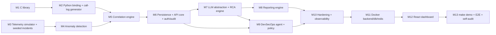

# Aegis-Net Implementation Plan

Status legend: `[ ]` not started · `[~]` in progress · `[x]` done and verified by
executed tests. A milestone is only marked `[x]` when its acceptance tests have
been run and passed; results are recorded in the milestone's *Verification log*.

Authoritative inputs: `PROJECT_SPEC.md` (functional spec) and `CLAUDE.md`
(engineering rules). Component interfaces live in `ARCHITECTURE.md`.

---

## 0. Environment baseline (verified 2026-10-19)

| Tool | Status | Notes |
|---|---|---|
| OS | Ubuntu 26.04.1 LTS on WSL2 (kernel 6.18), x86_64, 12 cores, 7.4 GiB RAM | |
| gcc | 15.2.0 ✅ | `-fsanitize=address,undefined` builds and runs; LeakSanitizer reports leaks (verified with a deliberate-leak probe) |
| cmake / make | 4.2.3 / 4.4.1 ✅ | |
| clang, clang-tidy, cppcheck, valgrind, ninja | ❌ not installed | ASan/UBSan/LSan cover memory checking; static analysers are optional |
| python3 | 3.14.4 ✅ | `venv`, `ensurepip`, `ctypes` available; `pip install` into a venv works (network OK) |
| Python libs (fastapi, pydantic, numpy, …) | ❌ not installed system-wide | Installed per-project into `backend/.venv` |
| node | ❌ **not installed in WSL** | `npm` on PATH resolves to the Windows install (`/mnt/c/Program Files/nodejs/npm`) and does not run. Frontend will be built/tested inside a `node` Docker image unless a native Node is installed |
| docker | 29.7.2 (Docker Desktop) ✅ | daemon reachable, `docker pull python:3.12-slim` succeeded |
| docker compose | v5.3.1 ✅ | |
| psql, redis-cli | ❌ | Not needed locally — Postgres/Redis run in containers |
| gh | ❌ | Not needed |
| git | 2.53.0 ✅ | repo on `master`, no commits yet |

Version skew to manage: local Python is 3.14, container images will use
Python 3.12. CI-style checks (`make test`) must pass on both or be run in the
container.

---

## 1. Global decisions

| ID | Decision | Rationale |
|---|---|---|
| D1 | C library lives in `c-library/` (spec §18) using the file layout of spec §3. Build output is `libcallanalyzer.so`. | Spec §3 and §18 give two paths; §18 is the monorepo layout. |
| D2 | Python ↔ C binding via **ctypes**. | No compiler needed at install time; library is loaded from an explicit path. |
| D3 | Analytics uses **numpy** only (no pandas). Isolation Forest/DBSCAN are optional and deferred (would add scikit-learn). | Interpretable methods required first (spec §6); avoid heavy deps. |
| D4 | Persistence: SQLAlchemy 2.x + Alembic; PostgreSQL in Docker. JSON columns use `JSON().with_variant(JSONB, "postgresql")` so the offline demo and unit tests can run on SQLite. | Spec §17 + §23 ("demo works without external infrastructure"). |
| D5 | LLM provider abstraction with `mock` (deterministic, default when no key), `anthropic`, `openai`, `local` (OpenAI-compatible endpoint). Vendor SDKs are optional extras, imported lazily. | Spec §20, §23. |
| D6 | DevSecOps agent operates only on a **disposable copy** of a synthetic demo service repo (`demo-workspace/`), never on this repository. Vulnerability data comes from a bundled synthetic advisory DB with IDs prefixed `DEMO-CVE-`. | CLAUDE.md: synthetic data, no arbitrary commands, keep changes contained. Avoids inventing real CVE claims. |
| D7 | "Deployments" and "rollback" are simulated through a deployment registry the telemetry simulator reads. This is documented as a simulation, not presented as real infrastructure control. | Spec §29: no fake functionality disguised as real. |
| D8 | Auth: bearer API tokens mapped to roles (`viewer`, `operator`, `approver`, `admin`), token hashes configured via env. | Spec §27; simple and testable. |
| D9 | Redis used for rate limiting and the agent job queue; an in-process fallback exists for the offline demo and tests. | Spec §19 lists Redis; must not be a hard dependency of `make demo`. |
| D10 | Observability: stdlib `logging` with a JSON formatter + `prometheus_client` `/metrics`. OpenTelemetry is optional/deferred. | Spec §21 "where practical". |

---

## 2. Milestones

Dependency graph:

M1 and M3 have no dependency on each other and may proceed in parallel.
Testing is part of every milestone (spec Phase 13 is distributed, not deferred).

### M1 — C call-analysis library `[x]` (core complete; Python-side verification in M2)

Scope: `c-library/` with `include/call_analyzer.h`, `src/{parser,analyzer,statistics,anomaly,utils}.c`,
`tests/test_call_analyzer.c`, `CMakeLists.txt`, `README.md`; root `Makefile` targets.

Features: CSV parsing (header detection, BOM, CRLF, quoted fields, blank lines),
field validation, lenient/strict modes with a parse report, overall statistics,
per-cell aggregation, failure-code breakdown, time-window aggregation,
caller behaviour aggregation, duration/signal/packet-loss analysis, robust
(median/MAD) outlier detection, error codes + `strerror`, explicit free functions.

Acceptance criteria:
- Builds with `-Wall -Wextra -Wpedantic -Werror` plus extra warnings (`-Wshadow -Wconversion …`) under gcc 15.
- All C tests pass in a normal build **and** an ASan+UBSan build with LeakSanitizer reporting zero leaks.
- Allocation-failure injection: every allocation site in parse/aggregate/detect paths returns `CA_ERR_NOMEM` without leaking.
- Public API never crashes on NULL arguments; returns `CA_ERR_NULL_ARG`.

Tests: parser (valid, header/no header, CRLF, BOM, quotes), malformed CSV
(missing fields, extra fields, non-numeric, out-of-range, over-long lines and
fields, bad timestamps, embedded NUL), strict vs lenient, memory (OOM injection
sweep, ASan/LSan), statistics (hand-computed expected values), per-cell,
failure-code, time-window, caller, anomaly detection (seeded bad cell detected,
clean data yields no cell anomalies), empty input, integer-overflow guards.

### M2 — Python binding and call-log generator `[ ]`

Scope: `backend/call_analyzer/` (ctypes wrapper), `scripts/generate_call_logs.py`.
`analyze_call_log(path) -> dict` returning total calls, success/drop rate,
average duration, per-cell stats, failure-code stats, anomalies, suspicious windows.

Acceptance: pytest calls the real `.so` (no Python re-implementation of the
math); results equal a pure-Python reference computed in the test on the same
fixture; error codes map to typed Python exceptions; generator is deterministic
for a given seed and its seeded faulty cell is detected by the C library.

Tests: binding round-trip, exception mapping, missing library error message,
generator determinism, generator→C anomaly detection.

### M3 — Network telemetry simulator and seeded incidents `[ ]`

Scope: `backend/app/simulation/` + `scripts/generate_network_metrics.py`,
`scripts/simulate_incident.py`. Causal model (CPU → processing delay → latency →
packet loss → call drops; memory leak → CPU), diurnal load, per-cell noise,
incident injectors for all nine incident types in spec §5, deployment/security/
application-log event streams, rollback recovery.

Acceptance: fixed seed reproduces identical output; Pearson correlation between
CPU and latency during the seeded incident > 0.7 and near zero/weak at baseline;
seeded memory-leak deployment produces the ordered signal chain of spec §24;
rollback returns metrics to within baseline bands.

### M4 — Analytics and anomaly detection `[ ]`

Scope: `backend/app/analytics/`. Moving average, rolling std, Z-score, EWMA,
thresholds, rate-of-change; ensemble scoring; anomaly objects per spec §6
(metric, timestamp, value, baseline, severity, anomaly_score, related_metrics).

Acceptance: on the seeded incident, anomalies are raised for memory, CPU,
latency, packet loss, throughput (drop) and call-drop rate, with timestamps
after the deployment; false-positive rate on a clean 24 h baseline below a
documented bound; each detector unit-tested on synthetic step/spike/ramp series.

### M5 — Correlation engine `[ ]`

Scope: `backend/app/analytics/correlation.py`. Groups metric anomalies, C-library
call anomalies, deployment, security and application events into incidents
using time-window proximity, shared cell/service topology and lagged
cross-correlation; produces `Incident` with symptoms, ordered events, suspected
causes and confidence.

Acceptance: seeded scenario yields exactly one incident containing the deployment
as the earliest event and the six symptoms; unrelated noise anomalies are not
merged; two separate incidents in one dataset stay separate.

### M6 — Persistence, API core, auth and audit `[ ]`

Scope: `backend/app/{models,schemas,api,services,security}`, Alembic migrations,
FastAPI app with OpenAPI. Tables for all spec §15 entities. Read endpoints for
calls, network, incidents, audit; `/api/health`. Token auth + RBAC; audit log
written for every mutating request and every agent/AI action.

Acceptance: `alembic upgrade head` succeeds on Postgres (container) and SQLite;
endpoint tests via `httpx`/TestClient with role matrix (401/403/200);
pipeline ingest stores incidents and they are returned by the API.

### M7 — LLM abstraction and RCA engine `[ ]`

Scope: `backend/app/rca/`, `backend/app/llm/`. `LLMProvider` (`generate`,
`tool_call`), providers: mock/anthropic/openai/local. Read-only RCA tool registry
(the nine tools in spec §8) with JSON-schema arguments validated by Pydantic.
Investigation loop with step budget; output validated against `RootCauseAnalysis`
schema with explicit `facts` / `inferences` / `hypotheses` / `recommendations`.

Acceptance: mock provider produces deployment-regression RCA on the seeded incident
using only tool outputs as evidence (each evidence item cites a tool call ID);
malformed/unknown tool calls from the LLM are rejected and logged; real
providers are exercised only if a key is present (tests skip otherwise, and the
skip is reported). Consult the `claude-api` skill before writing the Anthropic provider.

### M8 — Reporting engine `[ ]`

Scope: `backend/app/reporting/`. Report sections per spec §9; JSON, Markdown and
HTML renderers (Jinja2 with autoescape); PDF optional/deferred.

Acceptance: report for seeded incident contains every section, numeric findings
match analytics output, confidence present, HTML escapes injected strings.

### M9 — DevSecOps agent and action policy `[ ]`

Scope: `backend/app/agents/`, `demo-workspace/` template. OBSERVE→ANALYZE→PLAN→
ACT→VERIFY→CLOSE state machine; allowlisted tools (spec §10) each tagged with a
risk class; policy engine (READ_ONLY, LOW_RISK, REQUIRES_APPROVAL, HIGH_RISK,
BLOCKED); subprocess runner using argv lists only, fixed executables, timeouts,
confined cwd, scrubbed env; approval workflow; scenarios 1–3 of spec §11.

Acceptance: scenario tests reach expected end state; `REQUIRES_APPROVAL`/`HIGH_RISK`
actions never execute before approval; `BLOCKED` never executes; LLM-proposed
free-text commands are rejected; every action has a rationale and an audit row.

### M10 — Security hardening and observability `[ ]`

Rate limiting, request IDs, agent/incident IDs in log context, Prometheus metrics,
input-size limits, security tests (authz bypass attempts, path traversal in
report/log tools, injection strings).

### M11 — Docker (backend, postgres, redis) `[ ]`

Multi-stage backend image compiles the C library and runs its tests during build;
migrations on start; healthchecks. Acceptance: `docker compose up --build` from a
clean clone brings services to healthy and `/api/health` reports DB, Redis and
C-library status.

### M12 — React dashboard `[ ]`

React + TypeScript + Vite + Tailwind + Recharts; pages per spec §13; dark NOC
aesthetic; incident timeline; RCA explainability panel; agent approval UI.
Vitest + Testing Library component tests (run in a `node` container since Node
is absent in WSL). Acceptance: all pages render real API data; component tests pass.

### M13 — `make demo`, end-to-end tests, final audit `[ ]`

`make demo` runs the 13 demo steps offline with the mock provider; integration
tests for both pipelines in spec §22; README per spec §28 with Mermaid diagrams;
self-audit checklist of spec §31 executed and recorded.

---

## 3. Integration risks

| Risk | Impact | Mitigation |
|---|---|---|
| ctypes struct layout drift between `call_analyzer.h` and Python mirrors | Silent memory corruption | Library exports `call_analyzer_struct_sizes()`; binding asserts sizes at load time; tests compare. |
| Shared-library discovery across local / Docker | Import failure | Explicit `CALL_ANALYZER_LIB` env var, then known build paths; clear error. |
| Python 3.14 (local) vs 3.12 (image) wheel availability | Install failures | Pin compatible versions; run tests in both. |
| SQLite (demo) vs Postgres (prod) dialect differences | Migration/query bugs only seen in Docker | Portable types (D4); run migration + API tests against Postgres container in M6/M11. |
| Telemetry realism vs detector tuning | Detectors over-fitted to simulator | Test detectors on generic synthetic series, not only simulator output; document thresholds. |
| LLM nondeterminism and malformed tool calls | Flaky tests, unsafe actions | Mock provider for tests; Pydantic validation of every tool call; step budget; real-provider tests opt-in. |
| Agent subprocess execution | Command injection / host damage | Allowlist + argv-only + disposable workspace + policy engine + audit; no shell=True anywhere (enforced by a test that greps the codebase). |
| Node not installed in WSL | Frontend can't be built locally | Build/test via `node` image; document. |
| WSL2 + Docker Desktop bind-mount performance/permissions | Slow or failing dev containers | Prefer image builds over bind mounts for CI-style runs. |
| Scope size | Unfinished core features | Vertical slices; each milestone ends with passing tests; incomplete work listed explicitly. |

---

## 4. Requirements traceability

IDs refer to `PROJECT_SPEC.md` sections. "Test" names the test file / suite that
verifies the requirement once implemented. Status reflects executed tests only.

| Req | Spec § | Requirement | Component | Milestone | Verification test | Status |
|---|---|---|---|---|---|---|
| R1 | 3 | Real reusable C library with clean public API | `c-library/` | M1 | `test_call_analyzer.c` (all suites) | verified (C tests) |
| R2 | 3 | CSV parsing + validation, malformed input handling | `parser.c`, `utils.c` | M1 | `parser_*`, `malformed_*` cases | verified |
| R3 | 3 | Aggregations: drop, duration, cell, signal, failure code, time window, caller/callee | `statistics.c`, `analyzer.c` | M1 | `statistics_*`, `cell_statistics`, `failure_code_statistics`, `time_window_statistics`, `caller_statistics` | verified |
| R4 | 3 | Outlier detection | `anomaly.c` | M1 | `anomaly_*` cases | verified |
| R5 | 3 | Memory safety, NULL handling, overflow, leaks; `-Wall -Wextra -Wpedantic`; ASan/UBSan | `c-library/` | M1 | `make c-test-asan`, `oom_all_operations`, `null_arguments` | verified |
| R6 | 4 | Python binding, `analyze_call_log()` returning structured dict | `backend/call_analyzer/` | M2 | `backend/tests/test_call_analyzer_binding.py` | planned |
| R7 | 5 | Correlated network telemetry simulator | `app/simulation/` | M3 | `test_simulator_correlation.py` | planned |
| R8 | 5 | Nine incident types simulated | `app/simulation/incidents.py` | M3 | `test_incident_injectors.py` | planned |
| R9 | 6 | Interpretable anomaly detectors + anomaly schema | `app/analytics/` | M4 | `test_detectors.py`, `test_anomaly_schema.py` | planned |
| R10 | 6 | Optional ML detectors (Isolation Forest/DBSCAN) | `app/analytics/` | deferred | — | deferred (optional) |
| R11 | 7 | Cross-source correlation → Incident object | `app/analytics/correlation.py` | M5 | `test_correlation.py` | planned |
| R12 | 8 | LLM RCA with structured tools; facts vs hypotheses | `app/rca/`, `app/llm/` | M7 | `test_rca_engine.py`, `test_rca_tools.py`, `test_rca_schema.py` | planned |
| R13 | 9 | AI report (JSON/Markdown/HTML; PDF optional) | `app/reporting/` | M8 | `test_reporting.py` | planned |
| R14 | 10 | Agent tools + OBSERVE…CLOSE loop | `app/agents/` | M9 | `test_agent_loop.py` | planned |
| R15 | 11 | Scenarios: vulnerable dependency, failed CI, production anomaly | `app/agents/scenarios/` | M9 | `test_agent_scenarios.py` | planned |
| R16 | 12 | Action risk classes, approval gating, rationale, logging | `app/agents/policy.py` | M9 | `test_agent_policy.py` | planned |
| R17 | 13, 25 | Dashboard pages, KPI cards, charts, NOC aesthetic | `frontend/` | M12 | Vitest component tests + manual check | planned |
| R18 | 14 | Interactive incident timeline | `frontend/`, `IncidentEvent` API | M12 | `Timeline.test.tsx`, API test | planned |
| R19 | 15 | Schemas for 11 entities, Pydantic at API | `app/models`, `app/schemas` | M6 | `test_schemas.py` | planned |
| R20 | 16 | REST API endpoints + OpenAPI | `app/api/` | M6–M9 | `test_api_*.py`, OpenAPI snapshot | planned |
| R21 | 17 | PostgreSQL, migrations, relational tables + JSON evidence | `alembic/` | M6 | `test_migrations.py` (Postgres + SQLite) | planned |
| R22 | 18 | Monorepo structure | repo | all | structure check in self-audit | in progress |
| R23 | 19 | `docker compose up --build` (frontend, backend, postgres, redis); C lib built in backend image | `docker-compose.yml`, Dockerfiles | M11, M12 | compose smoke test script | planned |
| R24 | 20 | LLM provider abstraction, env config, no committed keys | `app/llm/` | M7 | `test_llm_providers.py`, secret scan | planned |
| R25 | 21 | Structured logs, request/agent/incident IDs, metrics, audit | `app/observability/` | M6, M10 | `test_observability.py` | planned |
| R26 | 22 | C, Python, frontend, integration tests | all | every milestone, M13 | `make test` | planned |
| R27 | 23 | `make demo` offline with mock provider, 13 steps | `scripts/`, `Makefile` | M13 | `test_demo_e2e.py` + manual run | planned |
| R28 | 24 | Seeded memory-leak deployment incident + evidence chain | M3 simulator, M5, M7 | M3, M5, M7 | `test_seeded_incident_e2e.py` | planned |
| R29 | 26 | Explainability chain without hidden chain-of-thought | `app/rca/`, frontend RCA page | M7, M12 | `test_rca_schema.py`, `RcaPanel.test.tsx` | planned |
| R30 | 27 | AuthN, RBAC, approvals, rate limiting, safe subprocess, no LLM shell | `app/security/`, `app/agents/executor.py` | M6, M9, M10 | `test_auth.py`, `test_rate_limit.py`, `test_no_shell_true.py`, `test_executor_allowlist.py` | planned |
| R31 | 28 | README with 16 sections + Mermaid; docs/ | `README.md`, `docs/` | M13 (incremental) | self-audit checklist | planned |
| R32 | 31 | `make test`, `make demo`, `make clean`; self-audit | `Makefile` | M1 (test/clean), M13 (demo) | executed in M13 | in progress |

---

## 5. Verification log

Entries record commands actually executed and their outcome.

- 2026-10-19 — Environment baseline (section 0) gathered by direct command execution.
- 2026-10-19 — M1: `make c-build` compiles cleanly with `-Werror` and the extended
  warning set (gcc 15.2). `make test` (= `c-test` + `c-test-asan`): 4/4 ctest
  executables passed — shared-lib suite 27 cases / 449 checks; fault-injection
  suite 28 cases / 608 checks, with every allocation failure point exercised
  (parse 4, statistics 2, cells 2, codes 2, windows 2, callers 2, anomalies 34),
  each returning `CA_ERR_NOMEM` with NULL outputs. Under ASan+UBSan+LSan: no
  errors, no leaks (sanitizer runtimes confirmed linked via `ldd`).
- 2026-10-19 — M1 mutation check (scratch copy, not committed): removing a
  `free` in `calculate_cell_statistics` made the ASan run fail with a
  LeakSanitizer report; changing the drop-rate denominator made
  `statistics_small`, `cell_statistics` and `time_window_statistics` fail.
- M1 not yet verified: behaviour under clang / other compilers (not installed);
  static analysis (cppcheck/clang-tidy not installed); very large inputs
  (> 1M rows) for performance.
