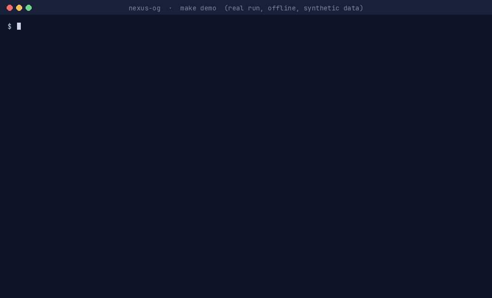
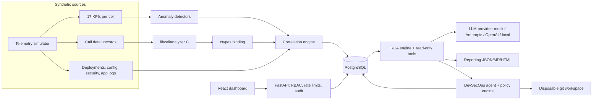
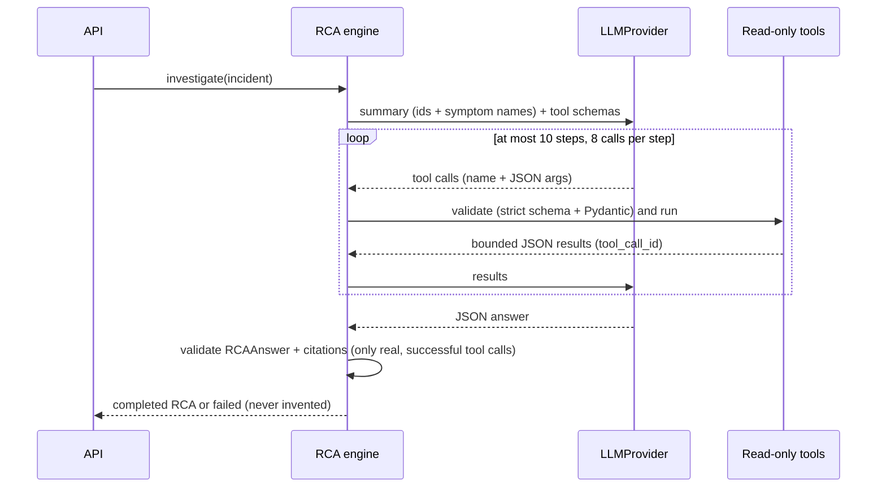
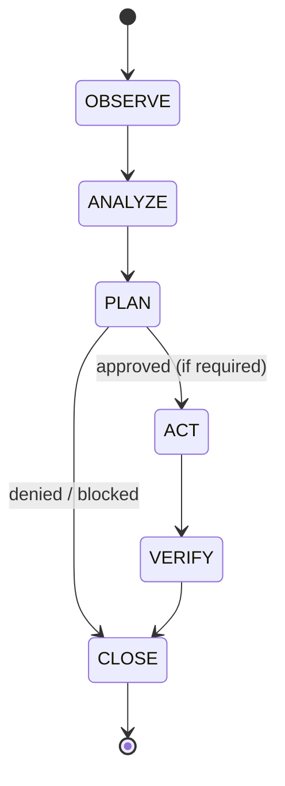

# nexus-og

The original, full build of nexus-ai (codename **Aegis-Net**, the name still
used inside the code, configs and documents). An integrated
network-intelligence and autonomous DevSecOps prototype. It does the following, and audits every AI decision and agent action:
- analyses telecom call logs with a C library;
- detects anomalies in network KPIs;
- correlates them with deployment, configuration and security events;
- runs a tool-driven AI root-cause analysis;
- writes incident reports;
- lets a policy-gated agent remediate safely.

> **All data is synthetic.** The telemetry, call logs, deployments, security
> events and `DEMO-CVE-*` advisories are generated by this project and do not
> describe real networks, packages or vulnerabilities. The production rollback
> is a simulation.

<p align="center">
  
</p>

<p align="center"><sub>Real run of <code>make demo</code> (offline, deterministic mock LLM, about 8 seconds end to end). Build output is trimmed and the report path is shortened; everything else is the program's own output.</sub></p>

---

## 1. Project overview

| Capability | What it does | Where |
|---|---|---|
| Call-log analysis in C | Parses and validates CDR CSV, aggregates by cell/code/window/caller, detects outliers | `c-library/`, Python binding `backend/call_analyzer/` |
| Network analytics | Deterministic telemetry simulator (17 KPIs, 9 incident types), interpretable anomaly detection, cross-source correlation into incidents | `backend/app/simulation/`, `backend/app/analytics/` |
| AI investigation | LLM provider abstraction, read-only investigation tools, validated root-cause analysis with facts/inferences/hypotheses, reports | `backend/app/llm/`, `backend/app/rca/`, `backend/app/reporting/` |
| Autonomous DevSecOps agent | OBSERVE→…→CLOSE playbooks for vulnerable dependencies, failed CI and production anomalies; sandboxed tools; approval workflow | `backend/app/agents/`, `demo-workspace/` |
| Platform | FastAPI + PostgreSQL + Redis, token RBAC, hash-chained audit log, metrics, React NOC dashboard | `backend/app/api/`, `frontend/` |

## 2. Architecture



Detailed contracts, schemas and data flow: [`ARCHITECTURE.md`](ARCHITECTURE.md).
Milestones, acceptance criteria and the verification log: [`IMPLEMENTATION_PLAN.md`](IMPLEMENTATION_PLAN.md).
Topic guides: [`docs/`](docs/).

## 3. Why C is used

CDR files are large, line-oriented and untrusted, which suits a small,
allocation-disciplined C library:
- bounded parsing (line, field and value limits, strict validation);
- O(n log n) grouped aggregation;
- robust (median/MAD) outlier detection, all behind a stable C ABI.

The library is built with `-Wall -Wextra -Wpedantic -Werror` plus 13 more
warning flags. It is tested under AddressSanitizer, UndefinedBehaviorSanitizer
and LeakSanitizer, and an allocation-failure-injection build checks every
`malloc` error path. Python calls it through ctypes and never re-implements its
computations. The binding verifies the struct layout of every field against the
header in its tests.

## 4. AI architecture



- **Providers** (`LLM_PROVIDER`):
  - `mock`: the default, deterministic and offline; a rule-based investigator, not an LLM.
  - `anthropic`: Claude, default model `claude-opus-5-5`.
  - `openai`.
  - `local`: any OpenAI-compatible endpoint.
  - When a selected provider lacks a key or SDK, the system falls back to the
    mock and reports the reason.
- **The LLM never executes anything.** It can only request one of nine
  read-only, incident-scoped tools, with validated arguments.
- **No hidden reasoning is stored.** Only structured facts, inferences,
  hypotheses, evidence references and recommendations are kept.

## 5. RCA workflow

Spec §26 explainability chain, as returned by `GET /api/incidents/{id}/rca`
and shown on the dashboard:

**observed evidence** (each fact cites tool calls) → **correlated events** →
**candidate hypotheses** → **hypothesis evaluation** → **most likely root cause**
(always labelled a hypothesis) → **confidence** (≤ 0.95) → **recommended
remediation** (each with a risk class).

## 6. Anomaly detection

Each KPI series runs through four detectors:
- z-score over a moving average and rolling standard deviation (time windows,
  so irregular sampling works);
- time-aware EWMA;
- static warning/critical thresholds;
- rate of change against recent healthy changes.

Statistical hits also need a per-metric *practical* deviation, and only clearly
normal points update the baseline, so ramps don't drag it along. Episodes
become spec §6 anomaly objects (metric, timestamp, value, baseline, severity,
score, related metrics). Measured false-positive rate on healthy data: 0.27
episodes per 100 series-days (bound: ≤ 1), none high or critical. The
correlation engine then groups anomalies by cell, node and time. It scores
deployments, configuration changes, attacks and symptom-only causes by
temporal precedence, topology and a causal graph. Anything that is not a
candidate is listed as excluded with a reason.

## 7. DevSecOps agent



| Scenario | Flow |
|---|---|
| `vulnerable_dependency` | scan → record finding (`DEMO-CVE-2026-0001`) → find smallest fixed release → **modify dependency (approval)** → tests → re-scan → report; never deployed |
| `failed_ci` | reproduce failure → CI log → diff last commit → hypothesis → generate revert patch → **apply patch (approval)** → tests + linter → report |
| `production_anomaly` | metrics → take incident → RCA → deployment registry → **rollback (HIGH_RISK: approval + admin + `AGENT_ALLOW_HIGH_RISK`)** → simulated rollback → verify recovery → resolve → report |

## 8. Security model

| Control | Implementation |
|---|---|
| API authentication | Bearer tokens, stored only as SHA-256 hashes (`AEGIS_API_TOKENS`), compared in constant time; accepted only in the `Authorization` header |
| RBAC | viewer < operator < approver < admin, enforced per endpoint |
| Agent permissions | Risk classes READ_ONLY / LOW_RISK / REQUIRES_APPROVAL / HIGH_RISK / BLOCKED. The policy is re-checked at execution, inside the service rather than only in the API. Separation of duties: the approver cannot be the run's initiator. HIGH_RISK actions are off by default and require admin execution. |
| Command sandboxing | Fixed executables (`python -m pytest|pyflakes`, allowlisted git subcommands); argv lists only (`shell=False`, enforced by an AST test); confined working directory; scrubbed environment; timeouts |
| Input validation | Pydantic bodies with `extra="forbid"`; patterns for ids, metrics and cells; 1 MB body limit (declared or streamed) |
| Rate limiting | Per-token or per-IP window in Redis, with an in-process fallback |
| Audit | Append-only hash chain covering denied auth attempts, every mutation, every RCA tool call, and every agent proposal, decision and execution. `GET /api/audit/verify` detects tampering. |
| Secrets | Read from environment only; masked in `repr`; never logged or returned (tested); `.env` is git- and docker-ignored |
| Output safety | HTML reports are autoescaped and served with a CSP; the dashboard renders them in a sandboxed iframe |

## 9. Installation

Requirements: Linux (tested on Ubuntu 26.04 under WSL2), gcc and CMake,
Python ≥ 3.12, Docker (for the stack, PostgreSQL/Redis tests and the dashboard
build). Node is **not** needed on the host; the dashboard builds in `node:22`.

```bash
make c-build     # build libcallanalyzer
make py-venv     # backend/.venv with pinned dependencies
```

## 10. Configuration

Copy-free setup: `make env` writes `.env` (it never overwrites one) with
generated token hashes and a Postgres password. The raw tokens go to
`.aegis-tokens` (mode 600). All variables are documented in
[`.env.example`](.env.example):

| Variable | Default | Meaning |
|---|---|---|
| `DATABASE_URL` | SQLite under `data/` (Docker: PostgreSQL) | SQLAlchemy URL |
| `AEGIS_API_TOKENS` | – | `name:role:sha256` entries (`scripts/hash_token.py`) |
| `LLM_PROVIDER`, `MODEL_NAME` | `mock` | `mock`, `anthropic`, `openai`, `local` |
| `ANTHROPIC_API_KEY`, `OPENAI_API_KEY`, `LOCAL_LLM_BASE_URL` | – | provider credentials / endpoint |
| `REDIS_URL` | – | rate-limit store (in-process fallback) |
| `AGENT_ALLOW_HIGH_RISK` | `false` | allow HIGH_RISK agent actions (still approval + admin) |
| `AEGIS_RATE_LIMIT_PER_MINUTE`, `AEGIS_MAX_REQUEST_BYTES` | 120 / 1 MB | hardening limits |

## 11. Running the demo

```bash
make demo                      # offline: SQLite, mock LLM, synthetic data (~15 s)
```

It runs the 13 steps of spec §23 through the real API with role-scoped
tokens:
1. generate telemetry and inject the incident;
2. analyse the call logs with the C library;
3. detect anomalies;
4. correlate them into an incident;
5. run the AI root-cause analysis;
6. generate a report;
7. invoke the agent and show the proposed rollback;
8. try to execute it before approval (refused);
9. approve it and execute it as admin (simulated);
10. verify recovery;
11. write the final report to `reports/`.

The full stack with the dashboard:

```bash
make env                       # once
docker compose up --build      # dashboard: http://127.0.0.1:8080  API: http://127.0.0.1:8000/docs
make docker-smoke              # isolated build + API smoke test (+ SMOKE_UI_CHECK=1 for a browser check)
```

Sign in to the dashboard with a token from `.aegis-tokens`.

## 12. API documentation

The OpenAPI UI is at `/docs` on the backend. Summary (details:
[`docs/api.md`](docs/api.md)):

| Endpoint | Role |
|---|---|
| `GET /api/health` | public |
| `POST /api/pipeline/run`, `GET /api/pipeline/runs` | operator / viewer |
| `GET /api/calls/statistics`, `/api/calls/anomalies` | viewer |
| `GET /api/network/overview`, `/metrics`, `/anomalies` | viewer |
| `GET /api/incidents`, `/api/incidents/{id}` | viewer |
| `POST /api/incidents/{id}/investigate`, `GET /api/incidents/{id}/rca` | operator / viewer |
| `POST /api/reports/generate`, `GET /api/reports`, `GET /api/reports/{id}?format=json\|markdown\|html` | operator / viewer |
| `GET /api/agent/status`, `/actions`, `/runs[/{id}]` | viewer |
| `POST /api/agent/investigate`, `/approve/{action_id}`, `/execute/{action_id}` | operator / approver / operator (admin for HIGH_RISK) |
| `GET /api/deployments`, `/api/security/findings` | viewer |
| `GET /api/audit`, `GET /api/audit/verify` | operator / admin |
| `GET /metrics` (Prometheus; not exposed through the dashboard proxy) | – |

## 13. Testing

```bash
make test             # C (normal + ASan/UBSan/LSan + fault injection), Python (normal + against the ASan library), mypy --strict, dashboard (tsc, Vitest, build)
make container-test   # C + Python suites inside python:3.12-slim
make docker-smoke     # full Docker stack smoke test
```

Opt-in tests, skipped unless configured:
- `AEGIS_TEST_POSTGRES_URL` (PostgreSQL migrations and pipeline);
- `AEGIS_TEST_REDIS_URL` (live Redis rate limiter);
- `AEGIS_RUN_LIVE_LLM_TESTS=1` with `ANTHROPIC_API_KEY` (live Claude RCA).

Recorded results for every milestone are in the verification log of
`IMPLEMENTATION_PLAN.md`.

## 14. Example incident

The seeded scenario (spec §24): packet-gateway **2.4.1** is deployed to node
`pgw-1` at 14:05 and leaks memory. The detected chain on CELL-101…104:

```text
14:05  deployment of packet-gateway 2.4.1 to pgw-1
14:13  memory_utilization anomaly         (57 % -> 98 %)
14:31  cpu_utilization anomaly            (GC pressure)
14:40  latency_ms anomaly                 (22 ms -> 250+ ms)
14:50  packet_loss_pct anomaly            (0.3 % -> 9 %)
14:53  call_drop_rate, throughput anomalies
       INC-2026-001 CRITICAL; leading hypothesis: deployment regression (0.89)
       RCA: deployment regression, 85 %; alternatives: memory exhaustion 34 %, security attack 5 %
       agent: rollback proposed (HIGH_RISK) -> approved -> executed (simulated) -> KPIs back to baseline -> resolved
```

A distractor hotfix deployment on `pgw-3` is listed as an excluded candidate.
The C library independently flags exactly the four affected cells.

## 15. Limitations

- **Synthetic only:** the simulator and the incidents are models. The
  detector thresholds were tuned on this simulator and generic synthetic
  series, not on real traffic.
- **Simulated rollback:** it re-simulates telemetry. `restart_service` is
  not modelled and always fails with an explanation.
- **Mock AI by default:** the default "AI" is a rule-based mock.
  - Anthropic, OpenAI and local providers are implemented. Their request
    shapes are checked against the installed SDKs, but they have **not** been
    exercised against live APIs here (no key).
  - The executive summary is the only LLM-written prose. Ungrounded numbers
    are rejected.
- **Deterministic agent:** the agent's playbooks are rule-based; the LLM
  only influences the RCA. Patches are limited to reverting the last commit.
- **Optional features not implemented:** Isolation Forest/DBSCAN, PDF
  reports, OpenTelemetry/Grafana.
- **Single-process limits:** pipeline runs and agent runs execute
  synchronously inside the request (seconds). The in-process rate-limit
  fallback is per instance.
- **Unauthenticated metrics:** `/metrics` has no auth; it isn't exposed
  through the dashboard proxy.
- **Not production-ready:** no HA, no secret manager, no TLS termination,
  no external identity provider.

## 16. Future improvements

- Run live-provider evaluations of the RCA prompts and tools, with a scored eval set.
- Add a streaming ingestion path (Kafka) and a time-series store for real telemetry.
- Add model-based detectors (Isolation Forest, seasonal decomposition) next to the interpretable ones.
- Generate patches beyond reverts, validated in the sandbox, and add real CI integration.
- Add OIDC sign-in, per-tenant RBAC, TLS and secret-manager integration.
- Add OpenTelemetry traces across the API, RCA and agent; ship Grafana dashboards.
